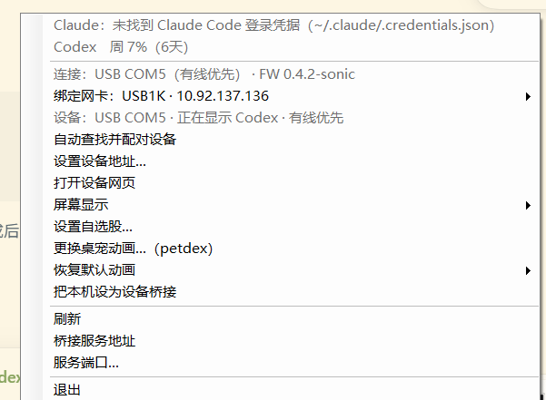

<p align="center">
  
</p>

<h1 align="center">AI Mac 小屏幕</h1>

<p align="center">桌上的一台 AI 状态小电脑 —— ESP8266 · 开源硬件 · 桌面伴侣</p>

<p align="center">
  中文 ·
  <a href="README.en.md">English</a>
</p>

<p align="center">
  <a href="https://mac.qust.me">官网</a> ·
  <a href="https://mac.qust.me/#flash">网页刷机</a> ·
  <a href="https://github.com/sonicmingit/esp8266-codex/releases/latest">下载</a>
</p>

<p align="center">
  
</p>

一块 240×240 的复古小电视，放在桌上实时显示 **Claude Code / Codex CLI 在干什么、额度还剩多少**。不需要额外 API key：数据来自本机已有的 CLI 登录凭据和会话日志，由 Mac / Windows 桌面桥接程序或 Linux Bridge 提供给设备。Windows 版支持 USB 有线优先，Linux Bridge 提供网页控制台、多设备管理和定时消息。

## 项目归属与本分支更新

本仓库基于原作者的 [pengchujin/esp8266-ai](https://github.com/pengchujin/esp8266-ai)。上游项目的 ESP8266 硬件与固件、Mac / Windows 桥接程序，以及桌宠、音乐、网速等原有功能归属于原作者及上游贡献者。本分支由 sonicmingit 维护，不改变上游归属，也不代表上游作者。详细版权与许可见 [NOTICE.md](NOTICE.md)。

本分支跟进并整理了上游已公开的修复，同时增加个人使用所需的扩展：

- 合并上游 Pull Request [#2、#10、#11、#16、#19、#21](docs/PR-UPGRADE-2026-08-11.md) 中适合本分支的修复与功能。
- Windows 客户端支持 CH340/CH343 USB 串口识别、`#HELLO` / `#DEVICE` 握手、有线优先和断线后回退局域网，并可通过串口更新额度、状态、网速与显示设置。
- 固件与 Windows 客户端提供 `0.4.4-sonic` 版本；可切换额度重置倒计时或具体日期时间，设置重启保留，也可在 USB 直连时关闭设备 Wi-Fi。
- 新增 Linux Bridge，支持 Docker 或原生部署、Codex / Claude 额度查询、Petdex 宠物上传、多设备配对与连接测试。
- Linux Bridge 可为每台小屏幕分别配置显示模式、常规/关闭/夜间亮度与定时开关屏；还可配置 Codex 每日定时消息、手动发送及最近结果记录。
- 保留上游 Mac 桥接及设备端宠物、音乐、网速等能力；部分功能需要局域网 HTTP 连接。

## 项目截图

| 设备实际使用 | Windows 桥接客户端 |
|---|---|
|  |  |

Linux Bridge 的 Docker / 原生安装方式和网页控制台说明见 [Linux Bridge 使用文档](linux-app/README.md)。

## 功能

| | |
|---|---|
|  | **AI 工作状态与额度**<br>桌宠动起来 = AI 正在干活。方形进度环 + 大字显示 5 小时 / 周额度的真实用量；额度用满自动换成重置倒计时，等你审批时整圈边框红闪提醒。 |
|  | **网速实时监视**<br>任务管理器风格的上下行曲线，56 秒滚动窗口，量程自动调整。 |
|  | **音乐播放显示**<br>专辑封面、歌名、歌手、进度条实时同步；音乐响起自动切入，停止自动切回。 |
|  | **可换桌宠**<br>内置 [petdex.dev](https://petdex.dev) 画廊 3300+ 开源桌宠，也可上传任意 GIF，设备板上直接解码，无需重烧固件。 |

## 快速上手

需要的东西：一台「SD2 小电视」开发板（[开源硬件](https://oshwhub.com/q21182889/sd2)，也可[直接购买成品](https://mobile.yangkeduo.com/goods.html?ps=OuBjGMWE82)）、一根 USB **数据**线。

### 第 1 步 · 刷固件（约 30 秒）

用 Chrome / Edge 打开 **[mac.qust.me/#flash](https://mac.qust.me/#flash)**，USB 连接设备，点「连接设备并烧录」，选择串口等待完成即可，无需安装任何工具。

> 弹窗里看不到串口？Windows 需要装 [CH340 驱动](https://www.wch.cn/downloads/CH341SER_EXE.html)，Mac 系统自带无需安装；换根 USB 线（很多线只能充电）；更多排查见[官网 FAQ](https://mac.qust.me/#flash-faq)。
>
> 命令行党也可以用 esptool 把 [Releases](https://github.com/sonicmingit/esp8266-codex/releases/latest) 里的 `esp8266-ai-firmware-*.bin` 刷到 `0x0`。

### 第 2 步 · 配 WiFi

设备首次开机会开热点 **`AI-Clock-Setup`**：手机连上后自动弹出配网页（没弹就用浏览器打开 `192.168.4.1`），选择家里 WiFi、输入密码，完成。

### 第 3 步 · 装桥接程序

从 [Releases](https://github.com/sonicmingit/esp8266-codex/releases/latest) 下载并打开：

- **macOS**：`AIClockBridge-*-macOS.dmg`，拖入 Applications（ad-hoc 签名，首次启动需在「系统设置 → 隐私与安全性」允许，并同意本地网络权限）
- **Windows**：`AIClockBridge-*-Windows-x64.exe`，双击即用；USB 连接 SD2 时自动使用有线数据通道，未插线时使用局域网
- **Linux**：按 [Linux Bridge 使用文档](linux-app/README.md) 使用 Docker 或原生方式部署；网页控制台可管理设备、查看额度和配置定时消息

Mac / Windows 桥接程序常驻菜单栏 / 托盘。Windows 会优先自动握手 USB 串口；未连接 USB 时，自动发现并配对同一局域网内的设备。Linux Bridge 通过网页控制台配对设备——到这里屏幕就活了。

日常使用都在托盘图标上：**左键**打开设备画面的实时镜像（底部有屏幕亮度滑条），**右键**是完整菜单（额度详情、屏幕切换、更换桌宠、音乐/网速页等）。
## 常见问题

- **屏幕边框红色闪烁**：设备连不上桥接程序——确认电脑端程序在运行、和设备在同一 WiFi。
- **额度一直显示 `-`**：本机没有登录过 Claude Code / Codex CLI，桥接程序读不到凭据。
- **想换桌宠**：右键托盘图标 → 「更换桌宠动画…」，挑一个点上传就行。
- **想看具体重置日期时间**：更新固件和桥接后，在设备设置网页的「额度重置时间」、Windows 托盘或 Linux 控制台的「重置时间显示」选择「具体日期时间」。5 小时和周额度均可查看，切回「倒计时」即可恢复剩余时长；设置重启保留，时区跟随桥接端。

## 开发

```
firmware/     ESP8266 固件（PlatformIO + Arduino，含板上 GIF 解码）
mac-app/      macOS 菜单栏桥接（Swift/SPM，零第三方依赖）
windows-app/  Windows 托盘桥接（C# / .NET 8 WinForms）
linux-app/    Linux 桥接与网页控制台（ASP.NET Core / Docker）
tools/        GIF → RGB565 内置精灵图转换脚本
docs/         开发文档（硬件引脚、HTTP API、架构细节）
```

```bash
cd firmware && pio run -t upload   # 固件：编译 + USB 烧录
cd mac-app && swift run            # Mac 桥接：本地跑起来
```

硬件引脚表、屏幕驱动的坑、设备 HTTP API、GIF 板上解码架构等细节见 **[docs/DEVELOPMENT.md](docs/DEVELOPMENT.md)**。

硬件、固件、软件全部开源，拿去改、拿去做、拿去卖都行。
