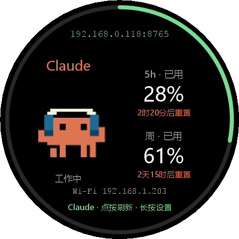

# v0.4.6-sonic · Xiaomi Watch 5 0.2.0 / 多网络与在线宠物

新增国行 Xiaomi Watch 5 原生 Android 应用，在圆屏上直接读取 Windows / Linux Bridge 的 Codex、Claude 额度。Windows 桥接更新到 0.4.6-sonic，支持手表与实体 SD2 同时使用。

## 手表端 0.2.0

- 保存最多 12 个桥接地址，按 Wi-Fi 的实际 IPv4 网段自动选择，支持 `/23` 等真实掩码、显式 CIDR 映射、同网段备用地址和公网回退，也可手动固定服务器。
- 首页显示桥接 IP/域名与端口、手表 Wi-Fi IP；采用左侧宠物、右侧额度与重置时间的圆屏布局，支持单应用、自动轮换和双栏。
- 手表直接联网搜索 Petdex 宠物，先下载预览，再分别应用给 Codex / Claude；宠物保存在手表，断网和重启可继续使用，也可恢复默认。
- 保留固件的真实 5 小时/周窗口判断、额度耗尽倒计时、重置日期、待审批提示和断线缓存。旧版单服务器设置自动迁移，APK 使用与 0.1.0 相同的本地签名，可覆盖安装。

## Windows 桥接 0.4.6-sonic

- `/status?client=watch` 返回原有额度数据，同时跳过实体 SD2 的被动发现，避免把手表 IP 当成实体设备配对地址。
- 现有 SD2 仍使用 `/status`；USB 优先、局域网回退和其他硬件功能沿用原有行为。

## 下载与升级

| 文件 | 用途 |
| --- | --- |
| `AIClockWatch-0.2.0.apk` | 国行 Xiaomi Watch 5 Android 应用；最低 API 26，目标设备基线 API 34 / 480×480 / 320dpi |
| `AIClockBridge-0.4.6-sonic-Windows-x64.exe` | Windows x64 自包含单文件，包含 .NET 运行时 |
| `esp8266-ai-firmware-0.4.5-sonic.bin` | 沿用上一版的 ESP8266 / SD2 固件，内容未变；本次手表功能无需重刷硬件 |
| `MANIFEST.txt` | 源码提交、各附件大小与 SHA-256 校验值 |

Windows 升级前退出旧托盘程序，再替换 EXE。手表覆盖安装 APK 后，长按首页进入设置，每行填写一个桥接地址，保存即可自动选址；「联网更换宠物」可进入对应应用的宠物目录。现有 Linux Bridge 无需更新协议。

完整安装、网络规则和构建说明见 [手表使用文档](https://github.com/sonicmingit/esp8266-codex/blob/v0.4.6-sonic/watch-app/README.md)。

## 验证范围

手表端 67 项协议、窗口、网段、回退和宠物目录断言通过；9 种圆屏场景的共享绘图预览已检查；APK 构建、v2/v3 签名与 zipalign 检查通过。Windows 额度回归及真实 HTTP 的手表/硬件发现隔离测试通过，Windows x64 自包含构建通过。

**手表 0.2.0 尚未完成真机安装和交互验收。** 已确认在线设备的型号与屏幕参数；新布局、Wi-Fi 切换、在线宠物下载/解码、键盘和 TalkBack 仍需覆盖安装后实测。以下是本地绘制的布局预览，非真机截图。

[完整变更](https://github.com/sonicmingit/esp8266-codex/compare/v0.4.5-sonic...v0.4.6-sonic)
