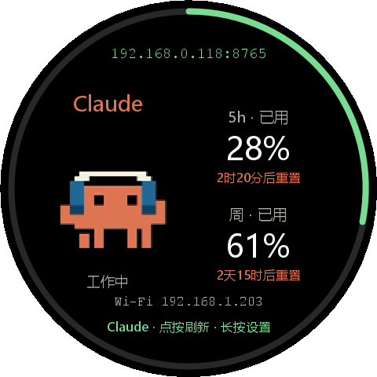

# AI 额度 · Xiaomi Watch 5

国行 Xiaomi Watch 5 的原生 Android APK。复用现有 ESP8266 固件的 `/status` 协议、额度窗口选择、自动切换规则和内置宠物帧，把方形边框改为圆形额度环。应用独立于实体小屏幕运行，直接连接 Windows 或 Linux Bridge。

当前版本 **0.2.0**，包名 `cn.sonic.aiclockwatch`。面向 Android 14 / 480×480 / 320dpi 国行设备。此次确认在线手表符合该基线，已装 0.1.0；新版安装命令被自动审批阻止，0.2.0 的触摸、键盘、Wi-Fi 切换和在线宠物仍待实测。APK 仅包含 Java 和资源，不依赖 GMS、Wear Data Layer 或本地 ABI 库。

安装包下载：[AIClockWatch-0.2.0.apk](https://github.com/sonicmingit/esp8266-codex/releases/download/v0.4.6-sonic/AIClockWatch-0.2.0.apk)；配套桥接和校验值见 [v0.4.6-sonic Release](https://github.com/sonicmingit/esp8266-codex/releases/tag/v0.4.6-sonic)。



## 0.2.0 更新

- 保存最多 12 个桥接地址，默认按手表 Wi-Fi 的真实 IPv4 地址和前缀长度匹配；支持 `/23`、`/16` 等网段。同网段失败后尝试备用地址，再回退公网域名；自动模式不探测其他局域网的私有地址，也不扫描全网。
- 允许用 `网段 = 地址` 显式绑定服务器，包括域名或经路由访问的地址。支持关闭自动选择、手动固定某个地址。旧版单地址自动迁移。
- 首页顶部显示实际读取数据的桥接 IP/域名与端口，下方显示手表 Wi-Fi IP。Wi-Fi 网络改变时取消旧请求、清除旧网络额度，再重新选址；无匹配时明确提示。
- 圆屏主体改为左侧宠物、右侧额度和重置时间。单周窗口放大数字，双窗口纵向排列；额度耗尽的倒计时也显示在右侧。
- 手表直接访问 Petdex，支持按中文名字或 slug 搜索、分页、下载预览，分别应用给 Codex / Claude，也可恢复默认宠物。下载后保存在手表私有目录，重启和断网可继续使用；待机、工作和待确认分别使用对应动画行。

地址设置示例（每行一个）：

```text
192.168.0.118:18765
192.168.10.20:8765
10.20.0.0/16 = https://office-bridge.example.com/ai
https://public-bridge.example.com
```

前三行的局域网地址/规则仅在匹配网络尝试，最后一行作为公网回退。手表 `192.168.1.203/23` 与服务器 `192.168.0.118` 在同一网段；不要按 IP 前三个数字简单判断。完全相同的私有网段出现在多个地点时，仅凭 IP 无法辨别地点，可用同网段候选轮询或关闭自动选择后手动固定。

## 使用

1. 运行 Windows Bridge **0.4.6-sonic**，或现有 [Linux Bridge](../linux-app/README.md)，确认服务中已有额度数据。Windows 托盘可查看桥接地址；手表须能访问对应网卡与端口。
2. 安装 `dist/AIClockWatch-0.2.0.apk`（相对仓库根目录）。启动「AI 额度」，每行填写一个桥接地址，选择「保存并连接」。
3. 例如填写 `192.168.1.20:8765`；也可填写 `http://192.168.1.20:8765`、`https://bridge.example.com` 或反代子路径 `https://bridge.example.com/ai`。自动补全 `/status`，裸主机默认端口 8765，完整 URL 使用其原有端口规则。
4. 点按表面刷新，长按进入设置，左右滑动依次切换自动 / Codex / Claude / 双栏。设置内可切换剩余额度、重置日期时间及前台保持亮屏；「联网更换宠物」可分别进入两家宠物目录，先预览再应用。

前台每 **15 秒**读一次桥接缓存；切到后台停止轮询与动画，返回时立即更新。默认不强制常亮。手表不调用账号用量 API，不接收 CLI 登录凭据，也不发送消息消耗订阅额度。

使用 ADB 安装和预填地址，先通过 `adb devices -l` 确认当前目标：

```powershell
./watch-app/install.ps1 -Serial '<当前设备序列号或IP:端口>' -Bridge '192.168.1.20:8765' -Mode codex
```

脚本需要现有的 ADB 连接；不会按历史 IP 自动连接。也可以手动执行：

```powershell
adb -s '<当前设备>' install -r ./dist/AIClockWatch-0.2.0.apk
adb -s '<当前设备>' shell am start -n cn.sonic.aiclockwatch/.MainActivity --es bridge '192.168.1.20:8765' --es mode codex
```

也可用启动参数 `--es bridges '192.168.0.118:18765,192.168.10.20:8765'` 预填多个地址（逗号分隔，替换列表）。`--es bridge` 保持旧行为并把地址加入列表。普通覆盖安装不需要启动参数，会保留原有地址、模式和开发签名。

## 与硬件一致的行为

- 百分比默认显示**已用**，外圈始终表示已用比例。可选「显示剩余额度」，数字改为 `100 - 已用`。
- Codex 没有真实短窗口时只显示周额度，不生成假的 5 小时额度。支持旧桥接把周窗口放在 `primary_pct`、`primary_window_min >= 1440` 的情况。
- 自动模式优先待审批方，其次唯一工作方；双方工作每 2 秒轮换，双方空闲每 6 秒轮换。固定模式不自动更换。
- 默认宠物只在对应应用工作且桥接数据新鲜时播放 6 帧动画。资产来自 `firmware/include/img/*_sprite.h`，包含原有 RGB565 字节序转换，归属沿用 [NOTICE.md](../NOTICE.md)。下载的 Petdex 宠物有待机/工作/等待动画，不改变来源工作状态。失联时回到待机。
- 额度耗尽时右侧显示重置倒计时，左侧保留宠物；周额度耗尽优先于短窗口。计时归零后等待桥接刷新，不自行把额度清零。
- 优先按服务器 `reset_at - ts` 在本地单调时钟上计时，避免手表时钟偏差。旧协议只有整数分钟时采用固件同样的半分钟估计。
- 具体日期跟随桥接 `utc_offset_min`；缺少时钟或时区时显示未知，不编造日期。断线保留最后数据并显示「缓存数据」，外圈红闪；待审批同样红闪提醒去电脑处理。
- Canvas 提供可朗读的两家额度、来源状态、缓存提示及点按/长按/切换操作；设置页使用原生控件。TalkBack 和实际大字体仍需真机验证。

本次移植聚焦额度页面及配套宠物/状态提示。宠物下载仅应用于手表；固件的音乐、网速、股票、向实体设备上传宠物和硬件亮度定时管理没有加入 APK。

## 在线宠物与缓存

目录来自 `https://assets.petdex.dev/manifests/petdex-v1.json`，资源限制为该服务的 HTTPS 图片，不跳过证书校验。原始精灵图必须是 1536×1872 的 8×9 网格，按现有桥接的 Petdex 格式提取待机第 0 行、工作第 7 行、等待第 6 行，每行 6 帧。缩放时保持宽高比，不裁掉角色。

目录下载限 8 MiB，图片限 12 MiB；有超时、取消、过期回调过滤和尺寸检查。目录下载失败时可浏览缓存并显示「离线目录」，新宠物仍需联网下载。应用前先下载/解码预览，只有点「用于 Codex/Claude」才原子保存到对应槽位；失败不替换现有宠物。手表系统原生 WebP 区域解码支持参见 [BitmapRegionDecoder](https://developer.android.com/reference/android/graphics/BitmapRegionDecoder)，真机链路仍待验证。

## 桥接兼容

手表发送 `GET /status?client=watch`。Linux Bridge 可直接接受查询参数。Windows **0.4.6-sonic** 会返回原有状态，同时跳过实体设备的被动发现，避免把手表 IP 写成 SD2 控制地址。已有硬件继续用 `/status`，发现逻辑保持可用；已通过真实本地 HTTP 回归测试。Windows 旧版也能返回数据，但需要升级才能避免手表干扰配对。

可先在与手表网络相通的电脑验证：

```powershell
curl.exe 'http://192.168.1.20:8765/status?client=watch'
```

响应应包含 `claude` 或 `codex` 对象。来源离线表示桥接端未取得新鲜状态，成功连接 HTTP 不等于账号数据已更新。连接失败时检查地址、Windows 托盘所选网卡、端口防火墙和 Wi-Fi 客户端隔离。

支持局域网 HTTP 及有受信证书的 HTTPS。HTTP 兼容方式遵循 [Android 网络安全配置](https://developer.android.com/privacy-and-security/security-config)；HTTPS 不跳过证书校验。当前不支持反向代理登录页、URL 内密码、访问令牌或自签名证书。

## 构建和测试

本机参考工程原路径 `E:/Code/Sonic/watch5` 不可达，因此此次在本仓库新建原生 Activity / View / Canvas 工程，采用 JDK 17、Android SDK 35、Build Tools 35.0.0，minSdk 26、targetSdk 34。

```powershell
# 已有工具可直接通过 build.ps1 参数指定，无需重复下载。
./watch-app/setup-tools.ps1 -Proxy 'http://127.0.0.1:7890'  # 无代理时省略 -Proxy
./watch-app/test.ps1
./watch-app/build.ps1
dotnet run --project windows-app/tests/Usage.Tests.csproj
```

`setup-tools.ps1` 仅下载官方 Android 工具和供 JVM 测试的 JSON 库，验证固定校验和。SDK 与测试库位于被忽略的 `.tools/`；JSON 测试库不打进 APK。设置 `JAVA_HOME`，或用 `-Jdk` 指定 JDK 目录；`build.ps1` 也接受 `-BuildTools` 和 `-PlatformJar`。

构建顺序为 aapt2 编译/链接资源 → javac → D8 → 打包 → zipalign → apksigner → 签名/对齐/Manifest 检查。第一次创建本应用专用的本地开发签名 `.signing/debug.keystore`，后续保留同一签名以便覆盖安装；不要提交该目录，也不要删除后期望新签名覆盖旧 APK。

宠物 PNG 已纳入源码，普通构建不需要 Python。固件帧发生变化后才运行 `python watch-app/tools/export_firmware_sprites.py`（需要 Pillow），再提交更新资源。

当前 67 项断言覆盖窗口归类、空值、0%、耗尽优先级、旧协议、时区/跨年/过期重置、模式切换、地址规范化、真实 HTTP 标识与错误、实际 `/23` 网段选择、Wi-Fi 切换后的候选变化、公网回退、手动规则、宠物目录校验与搜索。`qa/generated/` 的 9 张预览复用实际 `WatchFace` 绘图代码，由 Java2D 输出，**不是 Android 或手表截图**。当前验证和真机待办见 [qa/VALIDATION.md](qa/VALIDATION.md)。
